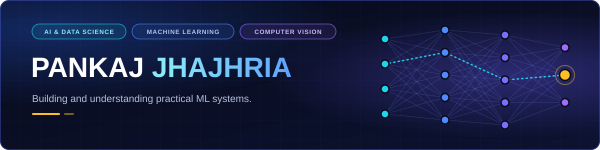

<!-- Pankaj Jhajhria | GitHub profile README -->

  

  <b>Engineering student building and evaluating practical machine-learning systems, from recommendation engines to multimodal segmentation.</b>

  
  &nbsp;&nbsp;
  

  <a href="https://github.com/Pankaj-Jhajhria">GitHub</a> ·
  <a href="https://www.linkedin.com/in/pankaj-jhajhria-a6a56735b/">LinkedIn</a> ·
  <a href="https://x.com/PkFlamer">X</a> ·
  <a href="mailto:pankajlilo252@gmail.com">Email</a>

  
    <a href="#about">About</a> · <a href="#engineering-focus">Engineering Focus</a> · <a href="#selected-projects">Selected Projects</a> · <a href="#technical-skills">Technical Skills</a> · <a href="#how-i-work">How I Work</a> · <a href="#problem-solving">Problem Solving</a> · <a href="#github-activity">GitHub Activity</a> · <a href="#education--contact">Education &amp; Contact</a>
  

| Project map | Where to look |
|:---|:---|
| **Machine learning** | [FilmSense](#filmsense) · [Satellite segmentation](#satellite-image-segmentation) |
| **Computer vision** | [RGB-thermal segmentation](#rgb-thermal-semantic-segmentation) · [SignBridge](#signbridge) |
| **Applications** | [FilmSense (live)](https://filmsense.streamlit.app/) · [Lost & Found (live)](https://lostfoundd.freedev.app/) |
| **Learning resources** | [Advanced_Python](https://github.com/Pankaj-Jhajhria/Advanced_Python) · [Git-Crash-Course](https://github.com/Pankaj-Jhajhria/Git-Crash-Course) |

## About

I'm a B.Tech student in Artificial Intelligence and Data Science at IIITDM Kurnool. I learn by building: I implement algorithms to understand how they work, test them on real datasets and model architectures, and measure what actually holds up.

My projects cover content-based recommendation, RGB-thermal and satellite image segmentation, and full-stack applications. I care about turning experiments into usable software that is documented, reproducible and deployed where it makes sense. Alongside project work, I practise structured problem solving in C++.

## Engineering Focus

| 🧠 **Machine Learning Systems** | 👁️ **Computer Vision & Deep Learning** |
|:---|:---|
| Content-based recommendation, weighted feature representations, TF-IDF and cosine similarity. | Semantic segmentation in PyTorch: encoder–decoder models, RGB and thermal inputs, class imbalance. |

| 🐍 **Data & Python Engineering** | 🛠️ **Software & Problem Solving** |
|:---|:---|
| pandas, NumPy and SciPy workflows, notebooks, and reproducible data preparation. | Streamlit and PHP/MySQL applications, Git workflows, deployment, and DSA in C++. |

## Selected Projects

### FilmSense

**Content-based movie recommendation** · `LIVE`

**Problem:** find similar films from a title, even with partial or misspelt input.
**Approach:** merge weighted metadata such as genres, keywords, director and cast into one text profile per film, vectorise it with TF-IDF, and retrieve neighbours by cosine similarity.

`Python` `pandas` `SciPy` `scikit-learn` `Streamlit`

**[Live Demo ↗](https://filmsense.streamlit.app/)** · [Source Code](https://github.com/Pankaj-Jhajhria/Movie-Recommendation-System-FilmSense-)

Technical details

- **Catalogue:** 3,911 films, vectorised into 27,548 TF-IDF terms (`app/data/Final_Dataset_2.csv`, `app/models/tfidf_matrix2.npz`).
- **Features:** metadata columns are tokenised and repeated according to their weight, so important fields such as genres and keywords count more.
- **Model:** `TfidfVectorizer(stop_words="english")` and `NearestNeighbors(metric="cosine", algorithm="brute")`.
- **Search:** exact, then partial, then fuzzy (`difflib`) title matching.
- **App:** Streamlit pages for Home, Explore, Top Rated, Genres and About. Watchlist is a placeholder.
- **Limitations:** content-based only, so results are not personalised. No quantitative evaluation has been run yet.
- **Code:** [`recommender.py`](https://github.com/Pankaj-Jhajhria/Movie-Recommendation-System-FilmSense-/blob/main/app/src/recommender.py) · [`app.py`](https://github.com/Pankaj-Jhajhria/Movie-Recommendation-System-FilmSense-/blob/main/app/app.py) · [TF-IDF notebook](https://github.com/Pankaj-Jhajhria/Movie-Recommendation-System-FilmSense-/blob/main/Notebooks/TF-IDF.ipynb) · [Recommendation engine notebook](https://github.com/Pankaj-Jhajhria/Movie-Recommendation-System-FilmSense-/blob/main/Notebooks/Recommendation_Engine.ipynb)

---

### RGB-Thermal Semantic Segmentation

**Multimodal urban-scene segmentation** · `IN PROGRESS` · college project, team of four

**Problem:** label every pixel of urban road scenes using thermal images alongside RGB.
**Approach:** an RTFNet-inspired ResNet-18 model in PyTorch that fuses RGB and thermal features, trained on the MFNet dataset and compared with teammates' architectures.

`PyTorch` `Semantic Segmentation` `Multimodal Learning` `Computer Vision`

Source code: not published.

Technical details

- **Dataset:** MFNet, 1,569 RGB-thermal image pairs at 640×480 (784 train, 392 validation, 393 test), nine classes including background.
- **Main challenge:** heavy class imbalance, with background making up about 92% of training pixels.
- **My part:** the model, dataset loader and training script for the RTFNet-based variant.
- **Evaluation plan:** report mIoU over all nine classes and over the eight foreground classes.
- **Status:** training and evaluation are ongoing. No final results are published yet.

---

### Satellite Image Segmentation

**Land-cover segmentation from satellite imagery** · `IN PROGRESS`

**Problem:** classify each pixel of a satellite image into land-cover types such as urban, agriculture, forest and water.
**Approach:** a U-Net baseline in PyTorch, built step by step through dataset inspection, a data pipeline, training and evaluation notebooks.

`PyTorch` `U-Net` `Semantic Segmentation` `Jupyter`

Source code: not published.

Technical details

- **Dataset:** 1,146 images (803 train, 171 validation, 172 test) with seven classes, including an `unknown` class.
- **Data finding:** only the 803 training images come with masks, which shapes how evaluation has to be set up.
- **Also built:** a separate five-class pipeline for the LandCover.ai dataset, kept apart from the first project's outputs.
- **Status:** no trained results are published yet.

---

### SignBridge

**Real-time Indian Sign Language alphabet translator** · `PROTOTYPE` · hackathon team project

**Problem:** turn webcam hand signs into text and speech.
**Approach:** MediaPipe hand landmarks become geometric features for a Random Forest classifier. Predictions are smoothed over time, assembled into text and spoken. A FastAPI and WebSocket interface runs in the browser.

`Python` `MediaPipe` `scikit-learn` `FastAPI` `WebSocket`

Source code: not linked.

Technical details and limitations

- **Scope:** static alphabet and digit signs only, not continuous sign language.
- **Accuracy:** about 99% on an offline holdout of images, but only about 70–80% in practical webcam testing. The offline figure is not real-world accuracy.
- **Not yet done:** signer-independent evaluation, dynamic signs, and deployment. The app runs locally.

---

### Lost & Found

**Web app for reporting and finding lost belongings** · `LIVE`

**Problem:** help people report lost or found items and contact each other.
**Approach:** a PHP and MySQL application with user accounts, lost and found reports with optional photos, search with a Lost/Found filter, WhatsApp contact links, and an admin panel for moderation.

`PHP` `MySQL` `HTML` `CSS`

**[Live Demo ↗](https://lostfoundd.freedev.app/)** · Source code: private

---

### Learning repositories

| 🐍 **[Advanced_Python](https://github.com/Pankaj-Jhajhria/Advanced_Python)** | 🔀 **[Git-Crash-Course](https://github.com/Pankaj-Jhajhria/Git-Crash-Course)** |
|:---|:---|
| Python scripts and notebooks covering APIs, file handling, OOP, NumPy and pandas, with datasets. | Git and GitHub notes with a command reference and a cheat sheet. |

## Technical Skills

| Area | Used in projects |
|:---|:---|
| **Languages** | `Python` `SQL` `PHP` `HTML` `CSS` |
| **Data & ML** | `NumPy` `pandas` `SciPy` `scikit-learn` `Matplotlib` |
| **Deep learning & vision** | `PyTorch` `MediaPipe` |
| **Apps & deployment** | `Streamlit` `Streamlit Community Cloud` `PHP + MySQL` |
| **Developer tools** | `Git` `GitHub` `Jupyter` |

**Currently exploring:** C++ and DSA · segmentation architectures (RTFNet, U-Net) · evaluating ML models.

## How I Work

This is my working approach across personal and college projects, not a professional process. Each project keeps its limitations in its README, and I report results only when I have measured them.

## Problem Solving

I'm working through a structured DSA roadmap in C++: complexity analysis, core data structures, searching and sorting, problem-solving patterns, and trees and heaps. I write my own study notes as I go. I don't show ratings or problem counts here.

## GitHub Activity

  <picture>
    <source media="(prefers-color-scheme: dark)" srcset="https://github-readme-stats.vercel.app/api?username=Pankaj-Jhajhria&amp;show_icons=true&amp;hide_border=true&amp;theme=dark&amp;bg_color=0a0f26&amp;title_color=22d3ee&amp;icon_color=7c6cff&amp;text_color=c8d0ea">
    
  </picture>
  <picture>
    <source media="(prefers-color-scheme: dark)" srcset="https://github-readme-stats.vercel.app/api/top-langs/?username=Pankaj-Jhajhria&amp;layout=compact&amp;langs_count=6&amp;hide_border=true&amp;theme=dark&amp;bg_color=0a0f26&amp;title_color=22d3ee&amp;text_color=c8d0ea">
    
  </picture>

Public data only. The language chart shows code composition, not skill level.

## Education & Contact

- **Education:** B.Tech in Artificial Intelligence and Data Science, IIITDM Kurnool
- **GitHub:** [Pankaj-Jhajhria](https://github.com/Pankaj-Jhajhria) · **LinkedIn:** [Pankaj Jhajhria](https://www.linkedin.com/in/pankaj-jhajhria-a6a56735b/) · **X:** [@PkFlamer](https://x.com/PkFlamer)
- **Email:** [pankajlilo252@gmail.com](mailto:pankajlilo252@gmail.com)

  

Pankaj Jhajhria · AI &amp; Data Science · IIITDM Kurnool

